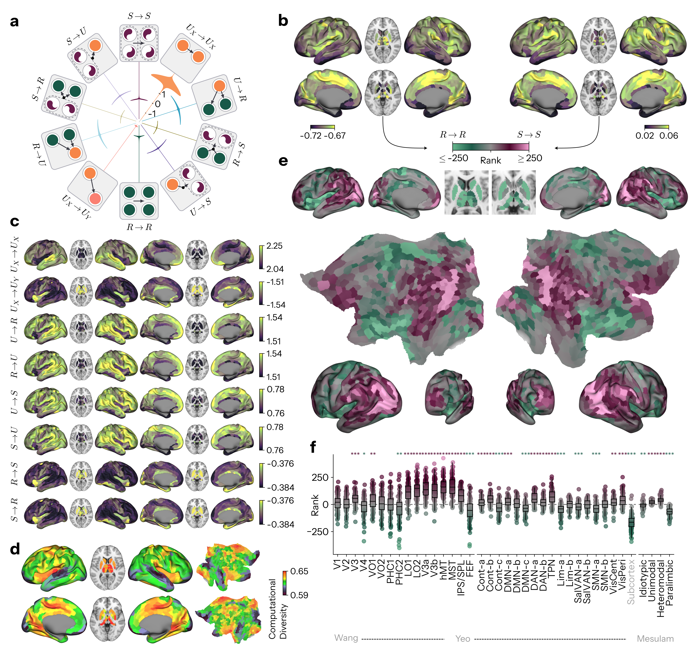

#### Code for Blackburne et al. (2026) "***The information architecture of the naturalistic human brain***"




`code/IG_phiid` contains the [repo](https://github.com/alberto-liardi/IG_PhiID) for computing (local) information-geometric integrated information decomposition ($\Phi\mathrm{ID}^{\text{IG}}$).

`code` contains the scripts for the project as:
- `nndb_phiid` computes $\Phi\mathrm{ID}^{\text{IG}}$ and computational diversity.
- `networks` runs the network analyses.
- `indidiffs` runs the individual differences analyses.
- `dynamics` runs the dynamics and cycle analyses.
- `matching` matches to gene expression and Neurosynth terms.
- `stimuli` relates atoms to the semantic content of the films.
- `replication/` reruns everything on the replication dataset.

`_s.py` scripts make the stats and figures, and `_utils.py` modules hold the helpers.

You will also need working installations of
- [pyNuMIT](https://github.com/alberto-liardi/pyNuMIT), for computing state-space entropy rate.
- [cortexcanvas](https://github.com/gblackburne/cortexcanvas), for plotting brain maps.


## Data

Data for the project is openly available from:

- [Naturalistic Neuroimaging Database](https://openneuro.org/datasets/ds002837) (OpenNeuro ds002837).
- [Naturalistic Neuroimaging Database 3T+](https://openneuro.org/datasets/ds006642) (OpenNeuro ds006642).

## Citation

If you use this code in your research, please cite:

```bibtex
@article{blackburne2026natural,
  title         = {The information architecture of the naturalistic human brain},
  author        = {Blackburne, George and Liardi, Alberto and Bacalum, Andreea and
                   Levchenko, Egor and Cooper, Greg and Dick, Fred and
                   Luppi, Andrea I. and Skipper, Jeremy I. and Mediano, Pedro A. M.},
  journal       = {bioRxiv},
  year          = {2026},
  doi           = {10.64898/2026.11.18.767548}
}

@article{liardi2026information,
  title         = {An information-geometric formulation of distributed computation},
  author        = {Liardi, Alberto and Blackburne, George and Mediano, Pedro A. M.},
  journal       = {arXiv preprint arXiv:2611.03545},
  year          = {2026},
  doi           = {10.48550/arXiv.2611.03545}
}
```

## License
> This software is distributed under the modified 3-clause BSD Licence.

`code/cycle_utils.py` is a lightly edited copy of [TINDA](https://github.com/OHBA-analysis/osl-dynamics/blob/main/osl_dynamics/analysis/tinda.py) from osl-dynamics, and remains under its [Apache 2.0 Licence](https://github.com/OHBA-analysis/osl-dynamics/blob/main/LICENSE).

\(C\) George Blackburne, Alberto Liardi - 2026.
